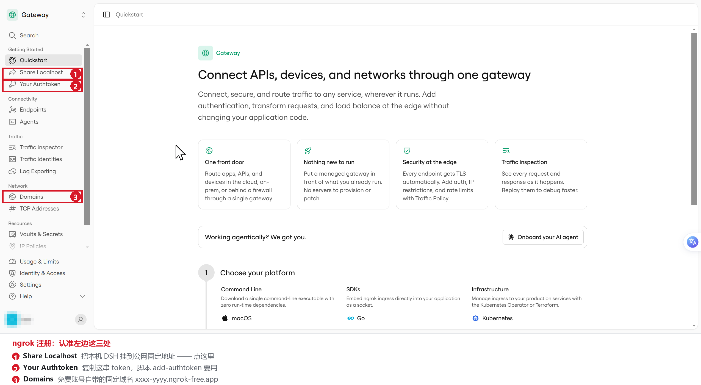

# DSH Remote — Android 远程控制器

[](https://dsh-plugin.org/plugins/liaoguogang-hub/dsh-remote-public)

手机原生 App，直接控制电脑上的 **DeepSeek Harness (DSH)**。不是 WebView 套壳：
Kotlin/Compose 直连 DSH 自带的 HTTP API + WebSocket 网关。

这是**公共版**，与作者自用版的唯一差别：

| | 自用版 | 本仓库（公共版） |
|---|---|---|
| 连接方式 | 局域网 / 自建中继 / 自定义 | 局域网 / **ngrok 隧道** / 自定义 |
| 内置服务器地址 | 有 | **无** |
| 内置登录凭证 | 有（30 天 cookie） | **无** |
| 包名 | `com.dsh.remote` | `com.dsh.remote.ngrok`（可与自用版共存） |
| 应用名 / APK | `DSH` / `DSH-Remote-v*.apk` | `DSH Remote` / `DSH Remote-v*.apk` |

两个版本 **UI 与功能同源**（同一套 Kotlin/Compose 代码），版本号各自独立递增；差异只在连接方式与是否内置凭据。

> ### 安装命令
>
> ```bash
> dsh plugin --profile desktop add dsh-remote-hub@0.4.7 --registry=https://registry.npmjs.org
> ```
>
> 建议**带上版本号与官方源**：DSH profile 默认 `minimumReleaseAge=1440`（24 小时），
> pnpm 遇到刚发布的版本会**静默回退**到很旧的版本而不报错（0.1.0 缺少扫码配对，表现为「扫码页打不开」）；
> profile 默认走国内镜像，新版本同步有延迟时也会报 `ERR_PNPM_NO_MATCHING_VERSION`。
>
> 装完用 `dsh-remote status` 确认（第一行显示「插件版本 v0.4.5」）；若装成了旧版本，重跑上面那条命令即可。
>
> 插件中心的安装按钮此前不带版本号，已反馈并获维护者确认修复：
> [dsh-plugin-hub#586](https://github.com/dshplugin/dsh-plugin-hub/issues/586)。修复后此处的版本号说明可简化。

## 下载手机端 App

**DSH Remote v4.21.3** · Android 8.0 (API 26) 及以上 · 2.8 MB

[⬇️ 下载 APK](https://github.com/liaoguogang-hub/dsh-remote-public/releases/download/v4.21.3/DSH-Remote-v4.21.3.apk) ·
[全部版本](https://github.com/liaoguogang-hub/dsh-remote-public/releases)

安装后应用名「DSH Remote」，包名 `com.dsh.remote.ngrok`（可与作者的 `DSH` 自用版共存）。
手机端不通过 npm 分发——npm 包 `dsh-remote-hub` 是电脑侧的 DSH 插件，两者配合使用：

```
电脑：dsh plugin --profile desktop add dsh-remote-hub@0.4.7 --registry=https://registry.npmjs.org → 起桥接 / 开隧道 / 签 Cookie
手机：装上面这个 APK → 填电脑给出的地址与 Cookie → 连接
```

## 扫码配对（手机端）

电脑上 `dsh-remote qr` 打开配对页 → 手机 App「设置 → 扫码配对」扫一下就自动填好地址与凭据，
不用手抄 Cookie。

二维码里**不含 Cookie**：只含一个 **10 分钟有效、用一次就作废**的配对码。
相机不可用时可以点「手动输入」，填地址 + 配对码同样能连上。

## 功能

| 能力 | 状态 |
|---|---|
| 三种连接方式（局域网 / ngrok / 自定义），地址与凭证首次填写后本地保存 | ✅ |
| 会话列表：搜索、排序（最近更新 / 手动）、归档筛选（隐藏 / 全部 / 仅归档） | ✅ |
| 会话列表默认显示最近 10 条，「展开其余 N 个会话」每次 +5 | ✅ |
| 长按会话：重命名 / 归档会话（或取消归档） | ✅ |
| 发消息、逐字流式回复、随时中断 | ✅ |
| 历史分页（「加载更早的消息」）与本地缓存（先显示上次内容再同步） | ✅ |
| 模型选择（分组目录 + 切换） | ✅ |
| 权限模式 | ⚠️ 只能读取当前值（DSH 未开放远程切换权限的接口） |
| 自定义地址历史（点选填入 / 删除） | ✅ |

## 三步连上（推荐：一键脚本）

1. **电脑上双击 `connect.cmd`**（和 App 一起发布的文件）。
   它会自动做四件事：起桥接 → 签发 30 天 Cookie → 尽量开公网隧道 → 打印结果。
2. 等黑窗口打印出这两行：
   - `DSH 地址: http://192.168.x.x:6300`（同一 WiFi，最快）
   - `Cookie: dsh-auth-…`（已自动复制到剪贴板）
   如果网络允许，还会多给一行公网地址 `https://xxx.trycloudflare.com`（人在外面时用）。
3. **App 里选「自定义」档** → 把地址粘进「DSH 地址」框 → Cookie 粘进「Cookie」框 → 点连接。

> 电脑端那个黑窗口要保持开着；关掉 = 断开手机。下次用重新双击一次，抄新的地址和 Cookie 即可。
> 结果同时会写到同目录的 `connect-info.txt`。

### 公网隧道说明

脚本按这个顺序尝试，**局域网地址永远可用**，公网则尽力而为：

| 情况 | 结果 |
|---|---|
| 装了 `ngrok` 且在 PATH 里 | 用 ngrok 开隧道 |
| 有 `cloudflared`（脚本会自动找/下载）且 `api.trycloudflare.com` 可达 | 免费 trycloudflare 地址，免注册 |
| 两者都不行（常见于受限网络） | 只给局域网地址，并提示需要自备内网穿透（cpolar / natapp / 花生壳 / 自建 frp） |

### 用 ngrok 拿一个永久固定域名（可选，需注册）

cloudflared 的免费 quick tunnel **每次重启地址都会变**；想要固定域名就用 ngrok 免费账号。




上图红框就是全部要点：① Share Localhost ② Your Authtoken ③ Domains。

**注册（约 2 分钟）**

1. 打开 <https://dashboard.ngrok.com/get-started/setup>，在首页选 **Share Localhost**
   （「Put your local app on a public URL」——它明确写着 *stable, auth-protected URL*）；
2. 跟着 **Get started** 走完，进 dashboard 后取两样东西：
   - **Authtoken**：左侧 `Getting Started` → `Your Authtoken`
     <https://dashboard.ngrok.com/get-started/your-authtoken>
   - **免费固定域名**：左侧 `Universal Gateway` → `Domains`，免费账号自带一个
     `xxxx-yyyy.ngrok-free.app` <https://dashboard.ngrok.com/domains>
3. 下载 ngrok 单文件（同样免安装、不需要管理员权限），放进 `tools\ngrok.exe`，或装到 PATH。

**配置（只需一次）**

```powershell
tools\ngrok.exe config add-authtoken <你的 Authtoken>
```

然后双击 `connect.cmd`：它会自己发现 ngrok、问你一次固定域名（记在
`%LOCALAPPDATA%\dsh-remote\ngrok-domain.txt`），之后每次都复用同一个地址。

> - **Host 必须改写**：脚本用 `--host-header=127.0.0.1:1815`，否则 DSH 的信任栅栏会 403，
>   而且 cookie 的 authority 对不上。
> - **不要加 ngrok 的 Basic Auth**：App 是用 DSH 的签名 cookie 认证的，Basic Auth 会让每个
>   API 调用先被 ngrok 拦下（401），App 连不上。安全性由 30 天签名的 cookie 保证。
> - **免费额度**：约 40 连接/分钟、1 GB/月。App 是长连接 + 流式输出，日常够用；
>   偶发断连多半是额度或连接数超限，可换付费或 cloudflared。

### 自己下载 cloudflared（可选，单文件免安装、不需要管理员权限）

脚本会优先在 `connect.cmd` 同目录、`tools\`、`%LOCALAPPDATA%\dsh-remote\` 等位置找
`cloudflared.exe`；找不到才下载。想自己放一份，按下面来：

```powershell
# 1) 镜像优先：国内直连 GitHub 下 52 MB 基本必超时
$url = "https://ghfast.top/https://github.com/cloudflare/cloudflared/releases/latest/download/cloudflared-windows-amd64.exe"
# 官方直连（网络允许时）：
# $url = "https://github.com/cloudflare/cloudflared/releases/latest/download/cloudflared-windows-amd64.exe"

$dest = "tools\cloudflared.exe"
New-Item -ItemType Directory -Force -Path (Split-Path $dest) | Out-Null
Invoke-WebRequest -Uri $url -OutFile $dest -TimeoutSec 300 -UseBasicParsing

# 2) 一定要验签：镜像可能给错文件，但签名伪造不了
Get-AuthenticodeSignature $dest | Format-List Status, SignerCertificate
```

合格标准：`Status = Valid`，`Subject` 里含 `Cloudflare, Inc.`。
参考值（2026.10.5 版）：`55,343,328` 字节，
SHA256 `DB4E4C413612A0916F3E1679D3CAAF376F94911952D163028FB726FB2E0516A9`。

> 脚本自己下载时也会做同样的验签（`Get-AuthenticodeSignature` + 主体含 Cloudflare），
> 校验不过就丢弃并换下一个源 —— **不要用哈希对比代替验签**，镜像可以把哈希一起改掉。

### 手工方式（想自己控制时）

```bash
node lan-proxy.mjs 6300 127.0.0.1:1815     # 桥接：把 Host 改写成 DSH 认可的 127.0.0.1:1815
ngrok http 6300 --host-header=127.0.0.1:1815   # 或 cloudflared tunnel --url http://127.0.0.1:6300
node mint.mjs "127.0.0.1:1815" 30              # 签发 30 天 Cookie
```

```text
浏览器打开 DSH 页面 → F12 → Application → Cookies → 复制会话 cookie
  （cookie 只对签发时的 authority 有效，所以桥接必须改写 Host 到同一个值）
```

## 安全说明

- **本仓库不包含任何地址、Token 或 Cookie**：`DshDefaults.kt` 里全是空字符串，首次连接在 App 里填。
- **Cookie 由你自己的电脑签发**：脚本用 `~/.dsh/.credentials.yaml` 里的密钥签一个 30 天有效的凭据，
  只在你自己机器和手机之间流动，不要提交到任何仓库。
- **局域网默认是明文 HTTP**：`lan-proxy.mjs` 监听 `0.0.0.0:6300`，同一 WiFi 内 Anyone 能访问它，
  所以请只在可信网络里用局域网模式；要跨网请用 ngrok / cloudflared 这类带 TLS 的隧道。
- **App 允许明文与用户证书**（`network_security_config.xml`）：DSH 通常跑在明文 HTTP 上，
  自签 CA 的中转也要能信任；代价是它不会阻止你连明文地址，所以地址来源要自己把关。
- **别把 ngrok 的 Basic Auth 和 DSH 的 Cookie 混用**：App 只带 DSH 的 Cookie，
  Basic Auth 会让每个请求先被隧道 401 拦掉。

## 构建

```bash
./gradlew assembleRelease      # 产物：dist/DSH Remote-v<version>.apk
```

需要 JDK 17 与 Android SDK（`local.properties` 指向本机 SDK）。

## 版本

当前 `4.12.2`（versionCode 58），与自用版 4.12.2 功能一致。

## 作为 DSH 插件安装（推荐）

本仓库根目录同时是一个 **DSH plugin**（Node 侧），装进 DSH 后由宿主负责起桥接、开隧道、签 Cookie，
并把地址与 Cookie 写进 `~/.dsh/dsh-remote/`，手机 App 直接抄。

```bash
# 从 NPM 安装（推荐，会出现在 DSH 内的「插件中心」）
# https://www.npmjs.com/package/dsh-remote-hub
dsh plugin --profile desktop add dsh-remote-hub@0.4.7 --registry=https://registry.npmjs.org
dsh plugin --profile web add dsh-remote-hub@0.4.7 --registry=https://registry.npmjs.org

# 或直接从本仓库源码安装（不经过 NPM）
dsh plugin --profile web add github:liaoguogang-hub/dsh-remote-public
```

装完重启 `dsh web`（或桌面端），插件会自动：

1. 起桥接：`0.0.0.0:6300`，把 Host 改写成 `127.0.0.1:1815`（Cookie 因此不会因端口变化失效）；
2. 自动发现 DSH 宿主端口（宿主每次重启都换端口，插件每次失败会重新扫一遍）；
3. 开隧道：**有 ngrok 就用 ngrok**（固定域名），否则自动下载并验签 cloudflared 开免注册 quick tunnel；
4. 签发 30 天 Cookie，写到 `~/.dsh/dsh-remote/status.json` 与 `connect.txt`。

查看结果：

```bash
dsh-remote qr         # 打开配对页（二维码），手机扫一下就自动填好
dsh-remote start --open   # 起桥接并打印地址/Cookie，同时打开二维码页（connect.cmd 用的就是它）
dsh-remote status     # 局域网地址、公网地址、Cookie、上游端口
dsh-remote connect    # 直接打印要抄进手机的两行
dsh-remote doctor     # 逐项自检：凭据、ngrok、cloudflared、宿主端口
dsh-remote start      # 不开 DSH 也能单独前台跑（Ctrl+C 退出）
```

插件配置（profile 行里覆盖即可）：

| 键 | 默认 | 作用 |
|---|---|---|
| `enabled` | `true` | 关掉插件但不卸载 |
| `port` | `6300` | 桥接监听端口（手机连这个） |
| `authority` | `127.0.0.1:1815` | 桥接呈现的 Host，Cookie 绑定它 |
| `tunnel` | `auto` | `auto` / `off` / `ngrok` / `cloudflared` |
| `upstreamPort` | `0` | 固定 DSH 宿主端口，`0` 表示自动发现 |

> 公网隧道受网络影响：`api.trycloudflare.com` 不可达时插件会跳过公网、只给局域网地址，
> 并在 `status.json` 里写明原因，不会假装成功。

> **安装时必须带版本号**（如 `@0.4.1`）。pnpm 11 默认开启 `minimumReleaseAge` 安全策略，
> 新发布的版本在一段时间内不会被 `@latest` 解析到，会**回退安装到很旧的版本**（0.1.0 没有扫码配对，
> 表现就是「扫码页打不开」）。显式写版本号可绕过该策略。

### 装完之后

插件随 DSH 启动自动工作，**不需要手动跑 connect.cmd**；装的时候没有提示是正常的，日志里会出现：

```
dsh-remote: ready — 手机端扫码：dsh-remote qr（或浏览器打开 http://127.0.0.1:<端口>/_dsh-remote/pair）
```

想手动确认/手动起，就在仓库目录双击 `connect.cmd`（它和插件是同一份代码，会打印地址与 Cookie 并自动打开二维码）。

**Cookie 跨重启有效**：桥接始终向 DSH 呈现固定 authority（默认 `127.0.0.1:1815`），
所以 DSH 换端口、桥接重启都不会让手机上的凭据失效；只有签名密钥变化或 Cookie 到期（30 天）才需要重新扫码。

> **不要让 `connect.cmd` 去"切换"一个由插件托管的桥接。** 插件模式下桥接跑在 DSH 进程内部，
> `connect.cmd` 会检测到并**拒绝重启**（而不是把 DSH 一起关掉），只打印该怎么改配置。
> 需要换公网配置时：改 `cordis.patch.yml` 的 `publicUrl` 后重启 DSH，或先完全退出 DSH 再双击 `connect.cmd`。

### 升级插件（重要：必须完全重启 DSH）

```bash
dsh plugin --profile desktop add dsh-remote-hub@0.4.7 --registry=https://registry.npmjs.org
# web profile 把 desktop 换成 web

```

**升级后请完全退出 DSH 再重新打开，不要只靠插件热重载。** 原因是旧版本的桥接监听可能不会被热重载回收，
它会继续占着端口，而这个"旧桥接"里没有新版本的路由：

| 症状 | 含义 |
|---|---|
| 配对页打不开，或打开是**乱码/无关页面** | 端口被**旧版桥接**占着，请求被它转发走了 |
| `dsh-remote status` 里 `bridgePort` 是 `0`、地址是 `http://x.x.x.x:0` | 旧版本绑不上端口的回退 bug（0.3.0 及更早） |

0.3.1 起这些都能自愈，但仍建议完全重启，理由是会残留**旧代码的监听**：

- 绑不上端口时先探 `/_dsh-remote/health`：
  - 是支持配对的本插件桥接 → 直接**采纳**，不重复开隧道；
  - 是旧版桥接（没有配对路由）或别的程序 → 自动**改用临时端口**，并在日志/`status.json` 里写明真实端口；
- 插件热重载时通过进程内注册表**先关闭上一实例**的监听。

升级后确认当前真实端口：

```bash
dsh-remote status        # 打印 bridgePort / 局域网 / 公网 / Cookie
# 或直接看健康检查
curl http://127.0.0.1:<bridgePort>/_dsh-remote/health
```

> 提示：`cordis.patch.yml` 里的 `port` 只是**首选**端口。若被占用，实际端口会写在 `~/.dsh/dsh-remote/status.json`，
> 一切链接与二维码都以那里为准，不必手改配置。

### 用自己的服务器做中转（阿里云等自建 relay）

如果你不用 ngrok，而是用一台云服务器（Caddy/nginx 终止 TLS + SSH 反向隧道）把本机暴露出去，
就让插件把这个地址写进二维码，否则扫码只会得到 ngrok/cloudflared 的地址：

```bash
# 方式一：临时环境变量
export DSH_REMOTE_PUBLIC_URL="https://your-relay.example"     # Windows: $env:DSH_REMOTE_PUBLIC_URL="https://..."
dsh-remote start --open

# 方式二：写进 profile 配置（推荐，长期有效）
# ~/.dsh/profiles/<name>/cordis.patch.yml 的 dsh-remote 行：
#   publicUrl: 'https://your-relay.example'
```

配置后插件不再启动 ngrok/cloudflared，并把该地址作为「公网地址」放进配对载荷；
启动时会探测 `<publicUrl>/_dsh-remote/health`，结果记在 `status.json` 的 `public.reachable`
（中转在、但反向隧道断了 → `false` 并打印警告）。

前提：服务器侧确实把请求转发到**桥接监听的端口**（默认 6300）。

### 扫码配对（一次性配对码）

不想手抄 Cookie 就用二维码：

```bash
dsh-remote qr
```

浏览器会打开 `http://127.0.0.1:6300/_dsh-remote/pair`，显示一个二维码。手机 DSH Remote 里点
「扫码配对」，扫完自动填入地址并换取登录凭据，直接连上。

扫码一次会同时写入「局域网」和「ngrok」两档地址；连接时优先局域网（同 WiFi 最快），局域网不通才走 ngrok。扫码后即保存，之后不用再扫。

安全设计：
- 二维码里**不含 Cookie**，只含一个 **10 分钟有效的一次性配对码**（`{"v":1,"u":"<地址>","c":"<配对码>","e":<过期时间>}`）；
- 兑换成功即作废，截图/偷拍泄漏的是一个立刻失效的码，而不是 30 天访问权；
- 配对码只存在内存里，插件重启即全部失效（失效安全）。

端点（都在桥接上，不经 DSH）：

| 方法 | 路径 | 作用 |
|---|---|---|
| GET | `/_dsh-remote/pair` | 配对页（二维码 HTML） |
| GET | `/_dsh-remote/pair.svg` | 只要二维码 SVG |
| POST | `/_dsh-remote/pair/redeem` | `{code}` → `{url, cookie}`；用过即失效 |

---

发版流程（版本号约定、tag 命名、发布 checklist、踩过的坑）：见 [RELEASING.md](RELEASING.md)
